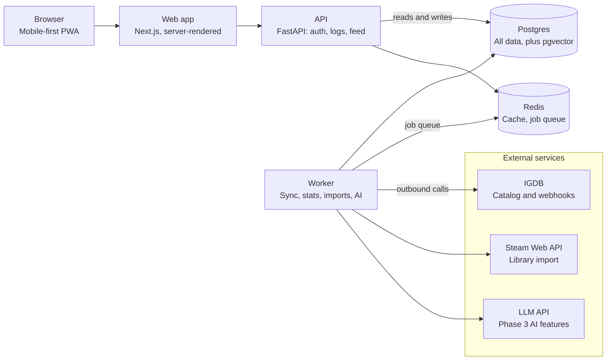

# Letterboxd for Music & Games — Plan

As of 2026-10-28 · Rohith

## Decision: launch with games, add music second

Start with video games. The catalog comes from one well-structured API, one game maps to one page, and the logging states (playing, finished, abandoned) give the diary more texture than "listened". Music follows in phase 2 on the same generic item model.

| Factor | Games | Music |
| --- | --- | --- |
| Catalog source | IGDB: one API for titles, covers, platforms, release dates; free with Twitch credentials | No single source. Spotify's Development Mode now caps apps at 5 allowlisted users, so MusicBrainz is the realistic base |
| Data shape | Game, with editions merged into a parent | Artist, release group, release, track; editions and reissues multiply pages |
| Log frequency | Lower: a game takes weeks | Higher: several albums a day, more feed activity |
| Biggest incumbent | Backloggd, ~650K registered users at end of 2025, no native app | Rate Your Music (1.6M accounts) and Album of the Year (~18M monthly visits), plus Musicboard and Record Club |
| Build effort for MVP | Lower | Higher, mostly catalog modeling |

The trade-off: music would generate more daily activity, but its catalog work would eat the first month.

## Landscape

The "Letterboxd for X" idea is proven in both markets, so the site has to win on a specific gap, not the concept. For games, the clearest gap is fast mobile logging: the market leader has no native app.

| Site | Medium | Scale or status | Where it falls short |
| --- | --- | --- | --- |
| [Backloggd](https://www.twoaveragegamers.com/backloggd-review/) | Games | ~650K registered users at end of 2025; run by a solo developer | Web only, no app; logging on a phone takes many taps |
| [GG](https://www.twoaveragegamers.com/backloggd-vs-gg-vs-savepoint/) | Games | Web, free tier plus premium | Weak import and export |
| [SavePoint](https://www.twoaveragegamers.com/backloggd-vs-gg-vs-savepoint/) | Games + tabletop | Newer; built on IGDB and BoardGameGeek | Small community |
| [Rate Your Music](https://en.wikipedia.org/wiki/Rate_Your_Music) | Music | 1.6M registered accounts (Aug 2026) | Dense, dated interface |
| [Album of the Year](https://kustiq.com/company/albumoftheyear.org) | Music | ~18.2M monthly visits | Review aggregator first, social second |
| [Musicboard](https://techradar.com/computing/software/were-confident-its-going-to-be-bigger-than-imdb-musicboard-founders-on-growing-a-community-and-how-its-earned-its-cult-status) | Music | iOS and Android apps | Users call it short of Letterboxd's polish |
| [Record Club](https://digitrendz.blog/newswire/technology/191407/record-club-aims-to-be-letterboxd-for-music-fans/) | Music | Covered in May 2026 as a clean Letterboxd-style option | Young, still building out |

Positioning for the games launch: log a game in under 10 seconds on a phone, import your Steam library on day one, and use an AI layer (taste matching, review summaries) as the differentiator. The game-tracker comparison posts come from a blog affiliated with SavePoint, so treat their framing with some care.

## MVP features

The MVP is Letterboxd's core loop for games: find a game, log it, rate and review it, and see what friends logged. Everything else waits until people use that loop.

**In the MVP**

1. **Search and game pages.** Cover, title, release year, platforms, developer, summary, average rating, and recent reviews.
2. **Log a game.** Status (want to play, playing, finished, abandoned), rating from 0.5 to 10 in half-point steps, platform played on, finish date, optional hours, and a replay flag. One log per playthrough, so a replay is a new diary entry.
3. **Reviews.** Text attached to a log, with a spoiler toggle and likes.
4. **Profile and diary.** Favorite four games, stats, a dated diary, and a backlog view.
5. **Lists.** Ranked or unranked, with notes per entry.
6. **Follow and feed.** Follow people; the home feed shows their logs and reviews in time order.
7. **Steam import.** Pull a user's Steam library into their backlog so the profile is never empty.

**Cut from the MVP**

- Native iOS and Android apps. Ship a mobile-first web app installable as a PWA.
- Comments on reviews, notifications beyond follows, and direct messages.
- Badges, streaks, challenges, and yearly recap pages.
- Custom covers, user-edited game data, and music.

## Catalog data

IGDB is the catalog for launch, called only from the backend and cached in your own database. Users never wait on IGDB, and the 4 requests per second limit never becomes your site's limit.

| Source | Used for | Access | Limits | Terms |
| --- | --- | --- | --- | --- |
| [IGDB](https://tech.dukeyin.com/2023/06/14/igdb-api-documents/) | Games, covers, platforms, companies, franchises, Steam IDs (`external_games`) | Twitch account with 2FA; OAuth client credentials; no browser calls (CORS blocked) | 4 requests/s, 8 open at once; 429 when exceeded | Free for non-commercial use; commercial use needs a partnership |
| [MusicBrainz](https://musicbrainz.org/doc/MusicBrainz_API) (phase 2) | Artists, release groups (albums), releases, tracks | No key; a descriptive User-Agent with contact info is required | About 1 request/s per IP; excess gets HTTP 503 | Non-commercial use is free; commercial plans available |
| [Cover Art Archive](https://wiki.musicbrainz.org/Cover_Art_Archive/API) (phase 2) | Album covers by release-group ID, sizes 250, 500, 1200 | No key | No rate limits stated | Per-image metadata says what each image may be used for |
| [Spotify Web API](https://developer.spotify.com/documentation/web-api/tutorials/february-2026-migration-guide) | Not used | Development Mode needs the owner on Premium | 5 allowlisted users; search returns 10 results per request | Extended access is gated; not viable for a public site |

**Sync strategy**

- Seed the `games` table with main games only (`version_parent = null`) so editions don't clutter search.
- Run search against your own Postgres; on a miss, hand the lookup to the worker's rate-limited IGDB queue, store the result, and return it.
- Register IGDB webhooks for create, update, and delete so cached games stay current without polling.
- Store IGDB `image_id` values and build cover URLs at render time rather than copying images.

## Data model

Everything users create points at a generic `items` table, not a `games` table. Adding music later means a new `kind` value and an `album_details` table, with no change to logs, reviews, lists, or the feed.

| Table | Key columns | Notes |
| --- | --- | --- |
| `users` | id, username, display_name, avatar_url, bio, steam_id, created_at | Username unique, used in profile URLs |
| `items` | id, kind (game, album), source (igdb, musicbrainz), source_id, title, slug, release_date, cover_image_id, summary | Unique on (source, source_id) |
| `game_details` | item_id, platforms, developers, genres, franchise | One row per game item |
| `logs` | id, user_id, item_id, status, rating, platform, started_on, finished_on, hours, is_replay, created_at | One row per playthrough; rating stored as an integer 1 to 20 (half-points, shown as 0.5 to 10) |
| `reviews` | id, log_id, body, has_spoilers, like_count, created_at | At most one review per log |
| `review_likes` | user_id, review_id, created_at | Primary key on the pair |
| `lists` | id, user_id, title, description, is_ranked, created_at | |
| `list_entries` | list_id, item_id, position, note | |
| `follows` | follower_id, followee_id, created_at | Primary key on the pair |
| `favorites` | user_id, item_id, position | Position 1 to 4 |
| `item_stats` | item_id, rating_count, rating_avg, weighted_rating | Recomputed by a background job, not on every log |

The feed for the MVP is a single query: logs from people you follow, newest first, backed by an index on `logs (user_id, created_at)`. Precomputed per-user feeds only become worth it at real scale.

Use a weighted rating for rankings so a game with three 10/10 ratings doesn't outrank one with 3,000 ratings averaging 9.2.

## Tech stack and architecture

Use a Python API with Postgres and a Next.js front end. Python keeps the backend and the later AI features in one language, and server-rendered pages let search engines index every game and review.

| Layer | Choice | Why |
| --- | --- | --- |
| Front end | Next.js (React, TypeScript), Tailwind | Server-rendered game and review pages are indexable; installable as a PWA |
| API | FastAPI | You've shipped services with it; shares a language with the AI layer |
| Database | PostgreSQL with `pg_trgm` (fuzzy title search) and `pgvector` | One database for catalog, user data, and embeddings |
| Cache and jobs | Redis plus a worker (ARQ or Celery) | Holds the IGDB rate-limit queue, stats jobs, and imports |
| Auth | Google sign-in and email magic links, handled in the API | No passwords to store in the MVP |
| Hosting | Vercel for the web app; Fly.io or Railway for API and worker; managed Postgres | The IGDB rate limiter needs a long-running process, not serverless functions |

If you'd rather lean on your Java experience, Spring Boot slots into the API box with nothing else changing.

Only the API and worker touch Postgres and Redis, and only the worker calls outside services, so IGDB's limits and outages never reach a page load.

## Build roadmap

Build in three phases, one step at a time, and move to the next phase only when the gate is met. Each step ends with something you can click.

**Phase 1: games MVP**

1. **Repo and local stack.** Monorepo with `web/` (Next.js) and `api/` (FastAPI); Docker Compose for Postgres and Redis; CI that runs tests and lint.
2. **Catalog.** Register a Twitch app, add IGDB token refresh, and build a client capped at 4 requests/s and 8 in flight. Seed popular main games into `items` and `game_details`. Add a trigram search endpoint.
3. **Auth and profiles.** Google sign-in and magic links, usernames, a bare profile page.
4. **Logging.** The log editor, a quick-log button on every game page, and the diary view.
5. **Reviews and game pages.** Reviews with spoiler toggle and likes; the `item_stats` job; game pages showing average rating and recent reviews.
6. **Social.** Follows, the home feed, and favorite four.
7. **Lists.** Create, reorder, and share lists.
8. **Steam import.** User links a Steam profile; the worker fetches owned games, maps them through IGDB's Steam IDs, and fills the backlog.
9. **Launch prep.** Page titles and share images for reviews, PWA manifest, request rate limits, a report button, IGDB attribution, privacy policy, deploy.

Gate to phase 2: a group of friends logging every week without being reminded.

**Phase 2: music**

1. MusicBrainz client with a descriptive User-Agent and a 1 request/s cap.
2. Release groups become `items` with `kind = album`; covers from Cover Art Archive.
3. Album-specific log fields (listen date, relisten) and a combined profile showing games and albums.

**Phase 3: AI layer**

1. Embed every review into `pgvector`; show "people with your taste" and similar games based on how people write about them.
2. Per-game summaries of what reviewers praise and criticize, refreshed nightly.
3. Natural-language search, such as "short co-op games for two people".
4. An evaluation set for each feature so summary and recommendation quality is measured, not guessed.

## Risks and open questions

This is a portfolio project, so it stays within IGDB's and MusicBrainz's free non-commercial terms. Licensing only becomes a risk if that changes: any ads or paid tier would need their commercial terms first.

| Risk | Mitigation |
| --- | --- |
| Commercial use of IGDB or MusicBrainz without an agreement | Stay non-commercial until you contact IGDB's partner team and MusicBrainz's commercial plans |
| Empty profiles and feeds at launch | Steam import on day one; seed a few curated lists; invite friends before strangers |
| Spoilers and abusive reviews | Spoiler toggle, report button, rate limits on posting, a simple admin queue |
| No clear reason to switch from Backloggd | Measure time-to-log on a phone and keep it under 10 seconds; lead with import and AI features |
| Scope creep as a solo builder | Ship phase 1 before touching music or AI |

**Open questions**

- [x] Portfolio project or a product you intend to monetize? Portfolio project, non-commercial.
- [ ] Site name and domain.
- [x] Rating scale: 10-point scale with half points (0.5 to 10).
- [ ] Steam Web API terms and profile-privacy requirements, to confirm before step 8.

## Sources

- [IGDB API documentation (mirror)](https://tech.dukeyin.com/2023/06/14/igdb-api-documents/)
- [MusicBrainz API](https://musicbrainz.org/doc/MusicBrainz_API) and [rate limiting](https://musicbrainz.org/doc/MusicBrainz_API/Rate_Limiting)
- [Cover Art Archive API](https://wiki.musicbrainz.org/Cover_Art_Archive/API)
- [Spotify February 2026 Web API migration guide](https://developer.spotify.com/documentation/web-api/tutorials/february-2026-migration-guide)
- [Backloggd review, Two Average Gamers](https://www.twoaveragegamers.com/backloggd-review/)
- [Backloggd vs GG vs SavePoint](https://www.twoaveragegamers.com/backloggd-vs-gg-vs-savepoint/)
- [Rate Your Music, Wikipedia](https://en.wikipedia.org/wiki/Rate_Your_Music)
- [Album of the Year company profile](https://kustiq.com/company/albumoftheyear.org)
- [Musicboard founders interview, TechRadar](https://techradar.com/computing/software/were-confident-its-going-to-be-bigger-than-imdb-musicboard-founders-on-growing-a-community-and-how-its-earned-its-cult-status)
- [Record Club coverage](https://digitrendz.blog/newswire/technology/191407/record-club-aims-to-be-letterboxd-for-music-fans/)
